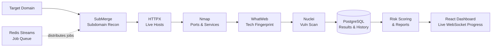

<div align="center">


<a href="https://github.com/umang-mishra23">
  
</a>


</div>

---

## `~/whoami`

```bash
umang@kali:~$ cat profile.txt

  Name        : Umang Mishra
  Role        : Security Researcher & Bug Bounty Hunter (HackerOne, Intigriti)
  Education   : B.Tech CSE @ Lovely Professional University (2023 - 2027)
  Focus       : VAPT | Attack Surface Management | Recon | Web & API Security
  Interests   : Threat Intelligence, OSINT, Detection Engineering
  Building    : AttackGrid, an enterprise ASM platform
  Writing     : Security walkthroughs on Medium
  Status      : 100+ web app assessments | 10+ valid vulns disclosed
```

---

## `~/featured-projects`

### [AttackGrid](https://github.com/umang-mishra23/Attack-Surface-Management-Platform): Enterprise Attack Surface Management Platform

A cloud-native ASM platform with distributed workers for scalable, asynchronous security scanning. It covers asset discovery, technology fingerprinting and vulnerability assessment, with multi-tenant risk scoring and executive reporting.



- Redis Streams job queues with worker heartbeat monitoring and retry/crash recovery
- Real-time scan progress over WebSockets
- Horizontally scalable worker deployment


### [SubMerge](https://github.com/umang-mishra23/SubMerge): High-Performance Subdomain Recon Engine

Aggregates multiple passive enumeration tools into one unified asset-discovery pipeline, with parallel execution, timeout handling, de-duplication, and DNSGen, MassDNS and HTTPX-based live-host detection. It is also the recon engine behind AttackGrid.


### Hands-On Pentesting Lab

An isolated multi-machine lab (Kali Linux, Metasploitable2, Windows 7) for simulating enterprise attack scenarios: port and service enumeration, CVE research, targeted Metasploit exploitation, privilege escalation, persistence, and full attack chains written up with remediation recommendations.

---

## `~/toolkit`

<div align="center">

| | |
|---|---|
| **Web & API** | `OWASP Top 10` `SQLi` `XSS` `CSRF` `IDOR` `SSRF` `Auth Testing` |
| **Tools** | `Burp Suite` `Metasploit` `Nmap` `Wireshark` `Nessus` `Nikto` `Nuclei` |
| **Recon** | `Attack Surface Discovery` `OSINT` `Network Recon` `Risk Assessment` |
| **SIEM & Detection** | `Splunk` `Wazuh` `Sysmon` `Windows Event Logs` `Linux Logs` |


</div>

---

## `~/achievements`

```text
[+] Top 3% globally on TryHackMe
[+] 100+ HackTheBox & TryHackMe machines completed
[+] 100+ security assessments on web applications
[+] 10+ valid vulnerabilities reported (IDOR, XSS, auth bypass)
[+] 8+ technical walkthroughs published on Medium
```

<div align="center">

[](https://tryhackme.com/p/Umang.Mishra?utm_campaign=social_share&utm_medium=social&utm_content=profile&cardVersion=45c818b9374d&utm_source=copy&share_date=2026-11-12&sharerId=67bb0ad8fa3e551288d88129)
[](https://profile.hackthebox.com/profile/019e1bca-30a3-71e4-a7ba-4c809ae8ba64?utm_medium=copy_url)
[](https://hackerone.com/YOUR_H1_USERNAME)
[](https://app.intigriti.com/profile/YOUR_INTIGRITI_USERNAME)
[](https://medium.com/@YOUR_MEDIUM_USERNAME)

</div>

---

## `~/certifications`

| Certification | Issuer | Year |
|---|---|---|
| Certified LLM Security Professional (CLLMSP) | RedTeam Leaders Academy | 2026 |
| Certified Ransomware Protection Officer (CRPO) | EU Cyber Academy | 2026 |
| Certified Cybersecurity Educator Professional (CCEP) | RedTeam Leaders Academy | 2026 |
| Android Bug Bounty Hunting: Hunt Like a Rat | EC-Council | 2025 |
| Red Hat System Administration I | Red Hat | 2025 |

---

## `~/github-stats`

<div align="center">


</div>

---

## `~/contact`

<div align="center">

[](https://linkedin.com/in/-umangmishra)
[](mailto:umangmishra2327@gmail.com)

```text
[ Open to internships, VAPT collaborations and responsible-disclosure work. ]
[ All testing is done ethically, with permission, in legal environments.    ]
```


</div>
